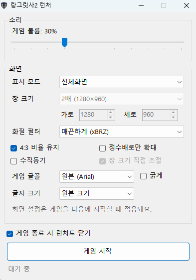

# Lang2Launcher

**랑그릿사 II (Windows판)를 Windows 10/11에서 편하게 실행하기 위한 런처**예요.

게임 볼륨 조절, [cnc-ddraw](https://github.com/FunkyFr3sh/cnc-ddraw) 화면 설정, 게임 글꼴 변경, Windows 10/11용 게임 버그 수정을 창 하나에서 할 수 있어요.

<p align="center">
  
</p>

> ⚠️ 이 저장소에는 **게임 파일이 포함되어 있지 않아요.** 게임은 직접 소유한 정품에서 준비해 주세요.

---

## 주요 기능

### 🔊 게임 볼륨만 따로 조절
- 원작에는 볼륨 조절 기능이 없어서, 런처가 Windows 볼륨 믹서의 **이 게임 항목만** 슬라이더 값으로 맞춰줘요.
- 게임을 시작할 때 자동으로 적용되고, **게임하는 중에도 슬라이더를 움직이면 바로 반영돼요.**
- 다른 프로그램 소리에는 영향을 주지 않아요.

### 🔉 효과음 음량 균형 자동 조정
- 다른 효과음보다 **약 2배 크게** 녹음된 효과음(주로 `DSF\RECORD49`~`95`)과, 체감상 큰 **맵 마법(스킬) 효과음**의 음량을 절반(-6dB)으로 낮춰요.
- **게임 시작을 누를 때** 자동으로 적용돼요. 처음 한 번 원본 효과음을 `DSF_ORIG` 폴더에 백업해요.
- 원본도 런처 결과물도 아닌 파일(직접 바꾼 효과음 등)은 건드리지 않아요.

### 🖥️ 화면 설정 (cnc-ddraw)
| 항목 | 설명 |
|---|---|
| 표시 모드 | 창 모드 / 전체화면(테두리 없음) / 전체화면 |
| 창 크기 | 1배(640×480) ~ 3배(1920×1440), 또는 사용자 지정 |
| 화질 필터 | **매끈하게 (xBRZ)** / **도트 보간 강하게 (xBR-lv3)** |
| 기타 | 4:3 비율 유지, 정수배로만 확대, 수직동기, 창 크기 직접 조절 |

- 설정은 `ddraw.ini`의 `[ddraw]` 섹션에서 **해당 항목만** 바꾸고, 나머지 설정은 건드리지 않아요.
- 화면 설정은 **다음에 게임을 시작할 때** 적용돼요.

### 🔤 게임 글꼴 바꾸기
원작은 한글이 없는 **Arial** 글꼴로 글자를 그려서, Windows가 다른 한글 글꼴을 끼워 넣어 그려요. 그래서 획이 들쭉날쭉하고, 화질 필터를 거치면 글자가 찌그러져 보여요.

| 항목 | 선택지 |
|---|---|
| 게임 글꼴 | 원본 (Arial) / **굴림** / 돋움 / 바탕 |
| 굵게 | 글자 굵기 400 → 700 |
| 글자 크기 | 원본 크기 / 95% / 90% / 85% / 80% / 75% |

- 상태창, 대화창, 메뉴 등 **게임 안의 모든 글자**에 같이 적용돼요.
- 한글 글꼴은 원본 크기에서 조금 크게 보일 수 있어요. 글자 크기를 **85~90%** 정도로 줄이면 칸에 잘 맞아요.
- 글자 크기는 **줄이기만** 할 수 있어요. 게임이 글자 한 칸 폭을 고정해 두고 잘라서 그리기 때문에, 키우면 글자가 잘리거나 겹쳐요.
- **게임 시작을 누를 때** `LANGPC2.EXE`에 적용돼요. 원본 (Arial) + 굵게 끔 + 원본 크기로 두면 원래 바이트로 돌아가요.

### 🩹 게임 버그 자동 수정
- 병사배속·아이템장비·지휘관배치 같은 **창 제목 글자가 안 보이는 문제**를 고쳐요. (Windows 10/11)
- 상태창에서 이름 없는 유닛의 클래스명 뒤에 `팔라딘 후`처럼 **엉뚱한 글자가 붙는 문제**를 고쳐요. (원작 한글판 버그)
- **게임 시작을 누를 때** `LANGPC2.EXE`의 해당 바이트만 자동으로 바꿔요. 이미 적용돼 있으면 건너뛰어요.
- 예상한 바이트가 아니면(다른 버전의 exe 등) 아무것도 바꾸지 않아요.
- `LANGPC2.EXE` 파일 자체를 고치기 때문에, 한 번 적용한 뒤에는 런처 없이 `LANGPC2.EXE`를 바로 실행해도 수정된 상태로 실행돼요.

> 💾 처음 적용하기 전에 `LANGPC2.EXE`를 따로 복사해 두는 걸 권장해요. (예: `LANGPC2_ORIG.EXE`)

### 기타
- 런처 설정(볼륨, 종료 옵션, 글꼴)은 `Lang2Launcher.ini`에 자동 저장돼요.
- "게임 종료 시 런처도 닫기" 옵션이 있어요.
- PowerShell이나 추가 런타임 없이 단독 실행 파일 하나로 동작해요. (.NET Framework 4.x는 Windows에 기본으로 들어 있어요.)

---

## 준비물

| 항목 | 받는 곳 | 비고 |
|---|---|---|
| 랑그릿사 II Windows판 게임 파일 | 직접 소유한 정품 | 실행 파일 이름이 `LANGPC2.EXE`여야 해요 |
| cnc-ddraw | [공식 릴리스](https://github.com/FunkyFr3sh/cnc-ddraw/releases) | `cnc-ddraw.zip` |
| Lang2Launcher | 이 저장소의 Releases 또는 직접 빌드 | |

---

## 설치 방법

1. **cnc-ddraw 넣기**
   [cnc-ddraw 릴리스](https://github.com/FunkyFr3sh/cnc-ddraw/releases)에서 `cnc-ddraw.zip`을 받아서, 아래 파일을 게임 폴더(`LANGPC2.EXE`가 있는 폴더)에 복사해 주세요.
   - `ddraw.dll`
   - `ddraw.ini`
   - `Shaders\xbrz\xbrz-freescale-multipass.glsl`
   - `Shaders\xbrz\xbrz-freescale-multipass.glsl.pass1`

2. **xBR-lv3 필터 넣기 (선택)**
   같은 zip 안의 `Shaders\shader-package.zip`을 열어서 `Shaders\xbr\xbr-lv3.glsl`을 게임 폴더의 같은 경로에 복사해 주세요.

3. **런처 넣기**
   `Lang2Launcher.exe`를 게임 폴더에 넣어 주세요.

4. **실행**
   `Lang2Launcher.exe`를 실행하고 **게임 시작**을 누르면 돼요.

### 설치 후 폴더 구성

```
게임 폴더/
├─ LANGPC2.EXE              ← 게임 (직접 준비)
├─ (그 외 게임 데이터 파일들)
├─ ddraw.dll                ← cnc-ddraw
├─ ddraw.ini                ← cnc-ddraw 설정 (런처가 편집)
├─ Shaders/
│  ├─ xbrz/xbrz-freescale-multipass.glsl
│  ├─ xbrz/xbrz-freescale-multipass.glsl.pass1
│  └─ xbr/xbr-lv3.glsl
├─ DSF/                     ← 효과음 (런처가 일부 음량 조정)
├─ DSF_ORIG/                ← 효과음 원본 백업 (런처가 자동 생성)
├─ Lang2Launcher.exe        ← 이 런처
└─ Lang2Launcher.ini        ← 런처 설정 (자동 생성)
```

---

## 직접 빌드하기

Visual Studio가 없어도 돼요. Windows에 기본으로 들어 있는 .NET Framework 4.x 컴파일러(`csc.exe`)를 써요.

```bat
build.bat
```

빌드가 끝나면 `dist\Lang2Launcher.exe`가 만들어져요. `icon.ico`가 있으면 아이콘으로 들어가요.

---

## 동작 방식

- **볼륨 조절**: Windows Core Audio API(`IAudioSessionManager2`)로 기본 출력 장치의 오디오 세션 중에서 게임 프로세스(PID)의 세션을 찾고, `ISimpleAudioVolume`으로 볼륨을 설정해요. 게임이 사운드를 초기화하기 전에는 세션이 없어서, 런처가 0.3초 간격으로 확인하다가 세션이 생기면 적용해요.
- **화면 설정**: `ddraw.ini`의 `[ddraw]` 섹션에서 다음 키만 읽고 써요.
  `windowed`, `fullscreen`, `width`, `height`, `shader`, `renderer`, `d3d9_filter`, `maintas`, `boxing`, `vsync`, `resizable`
- xBRZ, xBR-lv3 필터는 OpenGL에서만 동작해서, 필터를 고르면 `renderer=opengl`로 같이 설정돼요.
- **창 제목 글자 표시**: 창 제목을 그리는 함수(`0x422690`)가 글자색을 `SetTextColor(dc, -1)`로 지정해요. `-1`(`CLR_INVALID`)은 Windows 95/98에서는 흰색처럼 처리됐지만, NT 계열(Windows 10/11)에서는 무시돼서 글자가 그림자색(거의 검정)으로 찍혀요. 이 값을 정상적인 흰색 `0x00FFFFFF`로 바꿔요. (파일 오프셋 `0x21B5A`, 18바이트)

| 패치 | 파일 오프셋 | 원본 | 변경 |
|---|---|---|---|
| 창 제목 글자색 | `0x21B5A` | `8B 54 24 0C 6A 01 52 FF D7 8B 44 24 0C 6A FF 50 FF D3` | `8B 44 24 0C 68 FF FF FF 00 50 6A 01 50 FF D7 FF D3 90` |
| 이름 없는 유닛 이름 칸 (42칸) | `0x3FAB8 + 번호×4` (번호 0, 121, 204~243) | `30 ED 47 00` | `20 10 44 00` |

- **상태창 깨진 글자**: 상태창(`0x402E31`)은 클래스명 뒤에 유닛 이름 테이블(`0x4410B8`, 244칸)에서 `[유닛+0x37]`번 이름을 그려요. 이름 없는 유닛용 칸(0, 121, 204~243번)이 빈 문자열 대신 런타임 변수 주소(`0x47ED30`)를 가리키고 있어서, 그 변수 값(예: `C8 C4` = "후")이 엉뚱한 한글로 찍혀요. 이 칸들을 빈 문자열(`0x441020`)을 가리키게 바꿔요.
- **게임 글꼴**: 게임은 `0x42E293`의 루프에서 `CreateFontA`로 글꼴 5개(높이 20/24/32/64/256)를 만들어 모든 글자를 그려요. 원본은 글꼴 `Arial`, 문자셋 `ANSI_CHARSET`(0), 굵기 400, `NONANTIALIASED_QUALITY`예요. 런처는 아래 값만 바꿔요.

| 항목 | 파일 오프셋 | 원본 | 변경 |
|---|---|---|---|
| 글꼴 이름 (8바이트) | `0x46EEC` | `Arial` | `Gulim` / `Dotum` / `Batang` |
| 문자셋 | `0x2D6A4` | `53` (`push ebx`, 0 = ANSI) | `55` (`push ebp`, 이 시점 `ebp`=1 = `DEFAULT_CHARSET`) |
| 굵기 | `0x2D6A9` | `90 01 00 00` (400) | `BC 02 00 00` (700) |
| 높이 (`int` 5개) | `0x40EF8` | `20, 24, 32, 64, 256` | 고른 비율만큼 축소 |

- 글자 크기를 키우지 못하는 이유: 글자를 그리는 함수(`0x402740`)가 글자 1바이트당 9px 폭으로 잘라서 화면에 복사해요.

- **효과음 음량 균형**: `DSF` 파일은 `0x22`바이트 헤더(데이터 크기, WAVEFORMAT) 뒤에 16비트 모노 PCM이 이어지는 형식이에요. `DSF_ORIG`의 원본 중 아래 파일만 샘플에 0.5를 곱해 `DSF`에 써요.
  - 피크가 16,000을 넘는 파일 (보통 효과음의 피크는 약 7,000~13,500, 크게 녹음된 효과음은 약 17,600~23,700)
  - 맵 마법 연출에서 재생하는 효과음: `RECORD14, 16, 18, 24, 26, 34, 36, 46, 48, 50` (효과음 슬롯 7, 8, 9, 12, 13, 17, 18, 23, 24, 25)

---

## 문제 해결

**처음 실행할 때 "Windows의 PC 보호" 경고가 떠요**
서명되지 않은 프로그램이라 SmartScreen이 경고하는 거예요. **추가 정보 → 실행**을 누르면 돼요.

**필터를 바꿨는데 게임을 껐다 켜면 런처에서 필터가 다른 값으로 돌아가 있어요**
해당 셰이더 파일이 없거나, 그래픽 드라이버에서 그 셰이더를 지원하지 않는 경우예요. `Shaders` 폴더 경로가 맞는지 확인해 주세요.

**볼륨이 적용되지 않아요**
기본 출력 장치를 기준으로 동작해요. 게임 실행 중에 출력 장치를 바꿨다면 슬라이더를 한 번 움직여 주세요.

**병사배속/아이템장비/지휘관배치 창 위쪽 제목이 안 보여요**
런처의 **게임 시작**으로 실행하면 자동으로 고쳐져요. 상태 줄에 "알 수 없는 LANGPC2.EXE 버전" 메시지가 나오면 지원하지 않는 버전의 exe예요.

**상태 줄에 "LANGPC2.EXE에 쓸 권한이 없어서..."가 떠요**
게임 폴더가 `C:\Program Files` 같은 보호된 위치에 있거나 `LANGPC2.EXE`가 읽기 전용이에요. 게임 폴더를 바탕화면이나 `C:\Games` 같은 곳으로 옮기거나, 파일 속성에서 읽기 전용을 해제해 주세요.

**효과음을 원래 음량으로 되돌리고 싶어요**
`DSF_ORIG` 폴더의 파일을 `DSF` 폴더에 덮어쓰면 돼요. 단, 런처로 게임을 시작하면 다시 조정되니 `LANGPC2.EXE`를 직접 실행해 주세요.

**게임 글자가 너무 크거나 작아요**
런처의 **글자 크기**를 조절해 주세요. 굴림 기준으로 85~90%가 적당해요. 원래 글자로 돌리려면 게임 글꼴을 **원본 (Arial)**, 글자 크기를 **원본 크기**로 두고 굵게를 꺼 주세요.

**패치 전 원본 exe로 되돌리고 싶어요**
미리 복사해 둔 원본으로 `LANGPC2.EXE`를 덮어쓰면 돼요. 다시 런처로 게임을 시작하면 패치가 또 적용되니, 원본 그대로 쓰려면 `LANGPC2.EXE`를 직접 실행해 주세요.

**호환성 모드를 켜야 하나요?**
아니요. Windows 95/98 호환 모드는 Windows 11에서 관리자 권한을 요구하고 부작용이 있어서, **호환성 모드 없이 실행하는 것을 권장**해요.

---

## 알려진 문제

- 병사배속·아이템장비·지휘관배치 화면에서 창 제목이 창보다 **0.5초쯤 늦게** 나타나요. 화면 갱신 타이밍 문제로 보이며, 게임 진행에는 영향이 없어요.

---

## 라이선스

- 이 런처의 소스코드는 [MIT 라이선스](LICENSE)를 따라요.
- **cnc-ddraw**는 FunkyFr3sh의 프로젝트이고 MIT 라이선스를 따라요. 이 저장소에는 포함되어 있지 않아요.
- **셰이더(xBRZ, xBR-lv3)** 는 [libretro glsl-shaders](https://github.com/libretro/glsl-shaders)에서 나온 것이고, 각 파일의 라이선스를 따라요. 이 저장소에는 포함되어 있지 않아요.

## 면책

- 이 프로젝트는 비공식 팬 제작 도구이고, 랑그릿사 시리즈의 저작권자나 판권사와 관련이 없어요.
- "랑그릿사(Langrisser)"를 비롯한 관련 명칭과 게임 내용의 권리는 각 권리자에게 있어요.
- 이 저장소는 게임 파일, 게임에서 추출한 리소스(이미지, 아이콘, 음악 등)를 포함하지 않으며, 앞으로도 포함하지 않아요.
